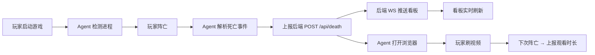

# GameDie 看板 · 产品需求文档（PRD）

## 1. 产品概述

GameDie 看板是 GameDie 项目的可视化前端，配合桌面 Agent 和后端服务使用。当玩家在射击游戏中阵亡时，Agent 自动打开浏览器跳转到预设视频网站刷视频；看板则让玩家配置重定向目标、实时查看死亡事件和观看时长统计。

- **目标用户**：常玩 PUBG / CSGO / Apex / 守望先锋的 PC 玩家
- **核心价值**：把"阵亡等待复活"的枯燥时间变成可量化的娱乐时长，并通过数据看板形成"越死越想刷"的轻量游戏化体验
- **设计调性**：暗色电竞氛围 + 苹果式精致排版（毛玻璃、清晰层级、克制留白），火焰橙红呼应"阵亡"主题，电光青呼应"游戏"主题

## 2. 核心功能

### 2.1 用户角色

无登录角色区分，单机本地部署，所有访客视为同一玩家。

### 2.2 功能模块

1. **看板主页（Dashboard）**：实时概览 + 死亡统计 + 观看时长统计 + 当前游戏状态
2. **配置页（Settings）**：重定向网站选择、自定义 URL、Agent 参数

### 2.3 页面详情

| 页面名称 | 模块名称 | 功能描述 |
| --- | --- | --- |
| 看板主页 | 顶部概览卡片 | 当前周期总死亡数、观看时长、当前运行游戏、最近一次死亡时间，含环比 delta |
| 看板主页 | 死亡趋势图 | 折线/柱状图，按日或按小时聚合，支持切换游戏筛选 |
| 看板主页 | 观看时长图 | 折线/堆叠图，按日聚合，按视频网站分组 |
| 看板主页 | 死亡游戏分布 | 环形图或条形图，展示各游戏死亡占比 |
| 看板主页 | 最近死亡事件流 | 实时滚动列表，新事件从顶部插入并高亮 |
| 看板主页 | 当前游戏状态条 | 显示当前正在运行的游戏及运行时长，无游戏时显示"空闲" |
| 看板主页 | 周期选择器 | 今日 / 昨日 / 本周 / 本月 / 全部 切换 |
| 配置页 | 重定向网站选择 | 预设卡片（抖音 / 哔哩哔哩 / YouTube / 自定义），点击切换 |
| 配置页 | 自定义 URL 输入 | 文本输入框 + 应用按钮，URL 格式校验 |
| 配置页 | Agent 参数 | 轮询间隔、是否启用截图（仅展示） |
| 配置页 | 测试按钮 | "立即测试重定向"按钮，调用后端触发一次模拟死亡 |

## 3. 核心流程

**主流程**：玩家打开看板 → 看板通过 WebSocket 连接后端 → 玩家继续游戏 → 阵亡时 Agent 上报后端 → 后端通过 WebSocket 推送给看板 → 看板实时刷新概览卡片与事件流，玩家同时看到浏览器自动打开刷视频。

**配置流程**：玩家进入配置页 → 选择预设网站或输入自定义 URL → 点击保存 → 后端 PUT /api/config → 立即生效（下次阵亡触发即跳转新 URL）。

## 4. 用户界面设计

### 4.1 设计风格

- **主色**：深空黑 `#0A0A0F` 主背景，配以炭灰 `#15151C` 卡片底
- **强调色**：火焰橙红 `#FF4D2E`（死亡主题）+ 电光青 `#00E5FF`（游戏主题）+ 霓虹绿 `#7CFF6B`（在线/正面数据）
- **次要色**：暖灰 `#8B8B9A` 文本辅助色
- **按钮风格**：圆角 10px、半透明渐变、悬停时发光（box-shadow + glow filter）
- **字体**：标题用 `Space Grotesk` 或 `Bebas Neue`（电竞感）+ 等宽 `JetBrains Mono`（数据展示），正文用 `HarmonyOS Sans SC` / `PingFang SC`
- **布局风格**：12 栅格、卡片式、毛玻璃背景模糊（backdrop-filter: blur(20px)）
- **图标风格**：线性图标（Lucide React）+ 极少 emoji
- **动效**：数据更新时数字滚动 + 卡片轻微脉冲、新事件插入时从顶部滑入并闪烁 2 秒、毛玻璃微抖动

### 4.2 页面设计概览

| 页面名称 | 模块名称 | UI 元素 |
| --- | --- | --- |
| 看板主页 | 顶部导航栏 | 左侧 LOGO + 中间页签（看板/配置）+ 右侧语言切换（中/英）+ 主题切换 |
| 看板主页 | 概览卡片区 | 4 个等宽毛玻璃卡片，火焰橙图标 + 大号数字 + 环比小箭头 |
| 看板主页 | 死亡趋势图 | 占 8 栅格，柱状折线复合图，渐变填充 |
| 看板主页 | 游戏分布 | 占 4 栅格，环形图 + 图例列表 |
| 看板主页 | 观看时长图 | 占 7 栅格，多色堆叠面积图 |
| 看板主页 | 最近事件流 | 占 5 栅格，时间轴样式列表，新条目发光 |
| 看板主页 | 当前游戏状态条 | 顶部贴附条幅，运行时显示游戏名 + 时长，火焰图标闪烁 |
| 配置页 | 重定向预设卡片 | 3 列卡片网格，选中态有橙色边框 + 内发光 |
| 配置页 | 自定义 URL | 输入框 + 应用按钮，URL 校验提示 |
| 配置页 | Agent 参数 | 表单卡片，禁用态字段灰显 |
| 配置页 | 测试按钮 | 全宽按钮，点击触发 toast 反馈 |

### 4.3 响应式

- 桌面优先（≥1280px 完整布局）
- 中屏（1024-1280px）改为单列卡片堆叠
- 移动端（<1024px）隐藏部分图表，保留概览卡片与事件流

### 4.4 3D 场景

无 3D 场景需求。可选轻量装饰：背景的微妙粒子飘落（CSS 实现）或鼠标跟随的光晕。
