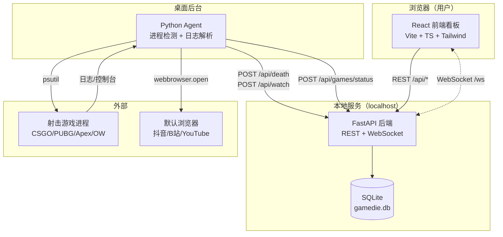
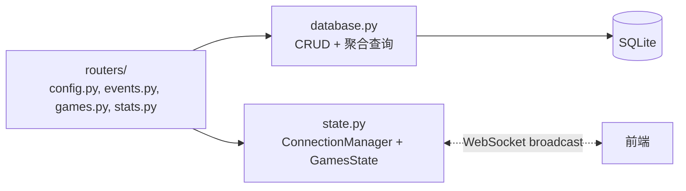
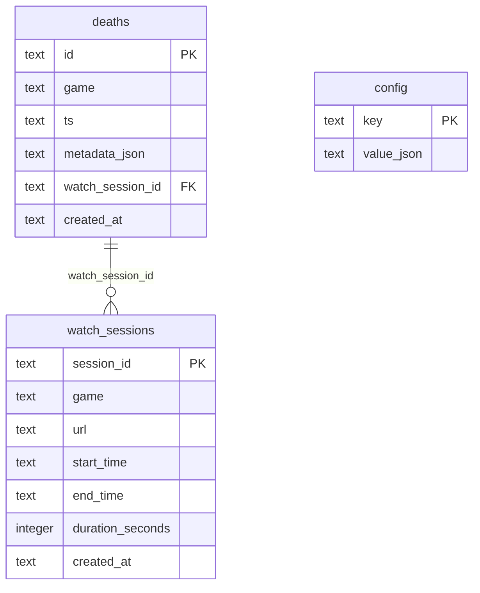

# GameDie 看板 · 技术架构文档

## 1. 架构设计



## 2. 技术说明

- **前端**：React@18 + TypeScript@5 + Vite@5 + TailwindCSS@3
- **图表**：Recharts@2（声明式、与 React 集成好、文档完善）
- **路由**：react-router-dom@6
- **国际化**：react-i18next@14 + i18next@23（中/英双语）
- **HTTP 客户端**：原生 `fetch` + 轻量封装，避免引入 axios
- **WebSocket**：原生 `WebSocket` API + 自定义 hook
- **图标**：lucide-react
- **动效**：framer-motion@11（页面切换、数字滚动、卡片入场）
- **字体**：Google Fonts 引入 Space Grotesk + JetBrains Mono + Noto Sans SC
- **初始化工具**：vite-init（react-ts 模板）
- **后端**：已有 FastAPI（监听 0.0.0.0:8000），无需新增
- **数据库**：已有 SQLite（backend/data/gamedie.db），无需新增

## 3. 路由定义

| 路由 | 用途 |
| --- | --- |
| `/` | 重定向到 `/dashboard` |
| `/dashboard` | 看板主页（概览 + 统计 + 事件流） |
| `/settings` | 配置页（重定向网站 + Agent 参数） |

## 4. API 定义

后端已实现，前端按以下协议对接：

```typescript
// 基础地址
const API_BASE = "http://localhost:8000";

// === 配置 ===
interface Preset { name: string; url: string; icon: string; }
interface AgentConfig { polling_interval: number; screenshot_enabled: boolean; }
interface AppConfig {
  redirect_url: string;
  presets: Preset[];
  agent: AgentConfig;
}
// GET /api/config
// PUT /api/config  body: Partial<AppConfig>

// === 游戏状态 ===
interface GameInfo {
  id: string;
  name: string;
  process_names: string[];
  running: boolean;
}
interface GamesStatus {
  games: GameInfo[];
  current_game: string | null;
}
// GET /api/games
// POST /api/games/status

// === 死亡事件 ===
interface DeathEvent {
  game: string;
  timestamp: string;  // ISO8601
  metadata?: Record<string, unknown>;
}
interface DeathResponse {
  event_id: string;
  watch_session_id: string;
}
// POST /api/death  body: DeathEvent  → DeathResponse

// === 观看时长 ===
interface WatchReport {
  session_id: string;
  start_time: string;
  end_time: string;
  duration_seconds: number;
  url: string;
}
// POST /api/watch  body: WatchReport → {ok: boolean}

// === 统计：死亡 ===
type Period = "today" | "yesterday" | "week" | "month" | "all";
interface DeathStats {
  period: Period;
  total: number;
  by_game: Record<string, number>;
  timeline: { date: string; count: number }[];
  by_hour: { hour: number; count: number }[];
  recent: DeathEvent[];
}
// GET /api/stats/deaths?period=&game=

// === 统计：观看 ===
interface WatchStats {
  period: Period;
  total_seconds: number;
  total_formatted: string;
  by_url: { url: string; name: string; seconds: number }[];
  timeline: { date: string; seconds: number }[];
  sessions: WatchReport[];
}
// GET /api/stats/watch?period=

// === 概览 ===
interface Overview {
  period: Period;
  deaths_total: number;
  deaths_delta: number;
  watch_seconds: number;
  watch_delta: number;
  current_game: string | null;
  last_death_at: string | null;
}
// GET /api/stats/overview?period=

// === 测试触发 ===
// POST /api/death/test  body: {game: string}  → 模拟一次死亡，触发浏览器打开（如后端已支持，否则前端直接调用 POST /api/death）

// === WebSocket ===
// ws://localhost:8000/ws
type WSMessage =
  | { type: "hello"; data: { server: string; time: string } }
  | { type: "death"; data: DeathEvent }
  | { type: "watch"; data: WatchReport }
  | { type: "games_status"; data: GamesStatus };
```

## 5. 服务器架构图

后端已有架构（仅描述，不在本前端任务中改动）：



## 6. 数据模型

### 6.1 ER 图（后端已有，前端只读）



### 6.2 DDL（已存在，前端开发无需重复执行）

```sql
CREATE TABLE IF NOT EXISTS deaths (
  id TEXT PRIMARY KEY,
  game TEXT NOT NULL,
  ts TEXT NOT NULL,
  metadata_json TEXT,
  watch_session_id TEXT,
  created_at TEXT NOT NULL
);
CREATE TABLE IF NOT EXISTS watch_sessions (
  session_id TEXT PRIMARY KEY,
  game TEXT,
  url TEXT,
  start_time TEXT,
  end_time TEXT,
  duration_seconds INTEGER,
  created_at TEXT NOT NULL
);
CREATE TABLE IF NOT EXISTS config (
  key TEXT PRIMARY KEY,
  value_json TEXT NOT NULL
);
```

## 7. 前端目录结构

```
frontend/
├── index.html
├── package.json
├── tsconfig.json
├── vite.config.ts
├── tailwind.config.js
├── postcss.config.js
├── src/
│   ├── main.tsx                # 入口
│   ├── App.tsx                 # 根组件 + 路由
│   ├── index.css               # 全局样式 + Tailwind
│   ├── i18n/
│   │   ├── index.ts
│   │   ├── zh.json
│   │   └── en.json
│   ├── api/
│   │   ├── client.ts           # fetch 封装
│   │   └── types.ts            # TS 类型定义
│   ├── hooks/
│   │   ├── useWebSocket.ts     # WS 连接 hook
│   │   └── useStats.ts         # 统计数据 hook（带轮询/缓存）
│   ├── components/
│   │   ├── Layout/
│   │   │   ├── TopNav.tsx      # 顶部导航
│   │   │   └── LanguageSwitch.tsx
│   │   ├── Dashboard/
│   │   │   ├── OverviewCards.tsx
│   │   │   ├── PeriodSelector.tsx
│   │   │   ├── DeathTrendChart.tsx
│   │   │   ├── GameDistribution.tsx
│   │   │   ├── WatchDurationChart.tsx
│   │   │   ├── RecentEvents.tsx
│   │   │   └── CurrentGameBar.tsx
│   │   ├── Settings/
│   │   │   ├── PresetCards.tsx
│   │   │   ├── CustomUrlInput.tsx
│   │   │   ├── AgentSettings.tsx
│   │   │   └── TestButton.tsx
│   │   └── common/
│   │       ├── Card.tsx        # 毛玻璃卡片基础组件
│   │       ├── NumberRoll.tsx  # 数字滚动动效
│   │       └── Toast.tsx
│   ├── pages/
│   │   ├── Dashboard.tsx
│   │   └── Settings.tsx
│   └── styles/
│       └── theme.css           # CSS 变量、字体、动画 keyframes
```
