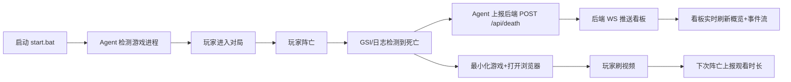
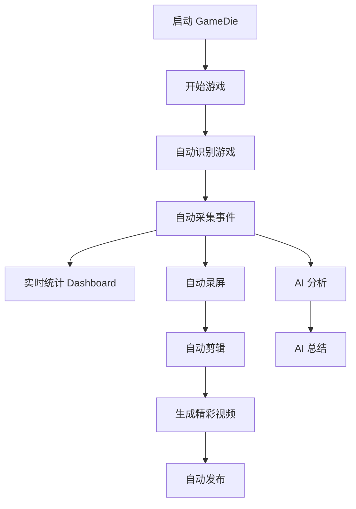

# 【标题】AI 应用赛道 · GameDie — 阵亡自动刷视频看板（本地 AI 游戏助手）

---

# 【正文】

## 一、自己 / 团队介绍

我是一名芯片设计行业的 **PM / FAE**，也是多年的 FPS 玩家（CSGO / PUBG / 守望先锋）。白天做产品定义与客户技术支持，晚上和周末做 Vibe Coding。

- **为什么做这个作品**：源于一次真实的尴尬体验——在 CSGO 一局中被颗秒后，无聊到反复切屏刷抖音。突然意识到"死亡时刻"其实是玩家情绪最低落、最需要转移注意力的瞬间，而这个瞬间完全可以被设计成一个"自动奖励窗口"。把"失败惩罚"反转为"娱乐奖励"，是这个创意的核心反转。
- **我擅长什么**：产品定义、用户场景拆解、跨层协作（Agent / 后端 / 前端）。技术实现上我并非科班，但擅长把一句话的需求交给 AI 长成完整系统。
- **Vibe Coding / 编程年限**：接触 Vibe Coding 约 1 年，编程断断续续 3 年左右，主要靠与 AI 结对推进。
- **性格标签**：致力于把"一句吐槽"做成"可运行系统"的产品型选手；最爱做"从 0 到 1"的原型验证；FPS 深度玩家，对"死亡真空期"有切肤之痛。

> 本部分不计入评分，主要用于赛事后续展示与推荐，真诚介绍以便让作品更有温度。

---

## 二、产品简介（复赛版）

### 是什么

GameDie 是一个 **本地运行的 AI 游戏助手（Local AI Companion）**。它通过读取游戏日志 / GSI / Demo / Replay / OCR 等方式感知游戏状态，在玩家阵亡时自动打开浏览器跳转到预设视频网站刷视频，并通过看板把"死亡—娱乐—时长"完整可视化与可复盘。

**形态**：桌面 Agent + 本地后端 + Web 看板 三端组成，纯本地运行，零上云、零侵入游戏（不修改游戏文件、不注入 DLL、不读取内存）。

**一句话核心价值**：把"阵亡等待复活"的枯燥时间，自动转化为可量化的娱乐时长，并在此基础上延伸出 AI 复盘、精彩时刻、自动内容创作等能力，形成"越死越想刷"的轻量游戏化闭环。

### 面向谁

- **核心用户**：常玩 CSGO/CS2、PUBG、Apex、守望先锋的 PC 玩家。
- **典型场景**：
  - 竞技对局中被击杀后 5–40 秒复活等待期，不想盯着死亡回放发呆；
  - 想量化"我在游戏里浪费了多少时间"的自我数据党；
  - 想自动产出对局复盘 / 精彩片段的内容创作者。

---

### 完整功能清单与用户使用路径

#### A. 当前已完成功能（初赛 Demo 已交付并实测）

| 模块 | 功能 | 说明 |
| --- | --- | --- |
| Agent 进程检测 | 自动识别运行中的射击游戏 | psutil 轮询 + 进程名匹配，支持 CSGO/CS2 实测，PUBG/Apex/OW 占位适配器 |
| 死亡检测 | CSGO/CS2 双重检测 | **GSI 主策略**（本地 HTTP 接收 CS2 推送，通过 `player.match_stats.deaths` 计数递增精确判死）+ **控制台日志兜底**（正则匹配 `Player X killed Y with Z` + 关键词兜底） |
| 自动打开视频 | 阵亡即跳转 | 拿到 watch_session_id 后最小化游戏窗口，打开默认浏览器跳转抖音/B站/YouTube/自定义 URL |
| 看板主页 | 实时概览 | 总死亡数、观看时长、当前游戏、最近死亡时间，含环比 delta，数字滚动动效 |
| 看板主页 | 死亡趋势图 | 柱状/折线复合图，按日或按小时聚合，可切游戏筛选 |
| 看板主页 | 观看时长图 | 堆叠面积图，按日聚合，按视频网站分组 |
| 看板主页 | 死亡游戏分布 | 环形图 + 图例 |
| 看板主页 | 最近事件流 | 实时滚动，新事件顶部插入并高亮闪烁 |
| 看板主页 | 当前游戏状态条 | 显示正在运行的游戏及时长，空闲态显示"空闲" |
| 看板主页 | 周期选择器 | 今日 / 昨日 / 本周 / 本月 / 全部 |
| 配置页 | 重定向网站选择 | 抖音 / B站 / YouTube / 自定义预设卡片，点击切换即时生效 |
| 配置页 | 自定义 URL | 输入校验 + 应用按钮 |
| 配置页 | Agent 参数 | 轮询间隔配置 |
| 配置页 | 测试按钮 | 立即触发一次模拟死亡，验证重定向链路 |
| 通信 | WebSocket 实时推送 | 死亡 / 观看 / 游戏状态事件实时广播到看板 |
| 数据 | 本地 SQLite | 死亡记录、观看会话、配置持久化，零上云 |
| 国际化 | 中英双语 | react-i18next，看板与配置页全覆盖 |
| 部署 | 一键启动脚本 | `start.bat` 支持 install / backend / agent / frontend / 全启 |

**用户使用路径（初赛闭环）**：

#### B. 复赛迭代升级（V2 规划方向）

定位从"阵亡自动刷视频"升级为 **"本地 AI Game Companion"**，形成"游戏开始 → 自动识别 → 自动采集 → 实时统计 → 自动录屏 → 自动剪辑 → AI 分析 → AI 总结 → 生成精彩视频 → 自动发布"的完整闭环。

**P0（决赛核心，差异化与完整闭环）**

1. **自动返回游戏**：Dashboard 支持自动关闭（5/10/30秒/自定义），关闭后自动 Alt+Tab 回游戏，降低使用成本。
2. **Timeline 时间轴**：新增页面，展示比赛时间轴（00:32 击杀 / 01:20 死亡 / 02:15 ECO / 03:44 ACE），点击事件可跳转对应录像片段。
3. **AI Match Summary**：比赛结束自动生成 MVP / 最大失误 / 最佳操作 / 死亡原因 / 经济分析 / AI 点评。

**P1（体验升级，演示亮点）**

1. **自动录屏**：支持 OBS / Windows Game Bar / Replay Buffer，发生精彩事件时自动保存最近 30 秒。
2. **精彩时刻识别**：自动识别 ACE / 残局 / 五杀 / 连杀 / 爆头 / 翻盘并自动保存。
3. **AI 剪辑**：自动生成字幕 / 标题 / 封面 / 简介，支持 B站 / 抖音 / YouTube。
4. **视频素材管理**：Media Library 统一管理录像 / 截图 / 封面 / 字幕。

**P2（未来扩展）**

1. **OCR 多游戏适配**：PUBG / LOL / Apex / 永劫 / 三角洲，作为辅助识别方式。
2. **AI Coach**：根据历史数据生成成长报告、训练建议、英雄/武器推荐。
3. **商业化**：SDK 授权模式（`npm install gamedie` + `subscribe()` 收到 PlayerKilled / PlayerDead / RoundStart 等事件）+ 设备合作（读取本地 DPI / 键盘 / 耳机 / 网络延迟，推荐合作商家三件套/加速器/游戏电脑）。

**用户使用路径（复赛目标闭环）**：

### 相比初赛 Demo 的升级

| 维度 | 初赛 Demo | 复赛成品 |
| --- | --- | --- |
| 定位 | 阵亡自动刷视频看板 | 本地 AI Game Companion |
| 死亡检测 | GSI + 控制台日志双重检测（已实测） | 继续保持 + 扩展多信号融合（Log/GSI/Replay/OCR/Vision） |
| 闭环 | 检测→刷视频→看板统计 | 检测→统计→录屏→剪辑→AI复盘→发布 |
| 用户操作 | 需手动切回游戏 | 自动返回游戏 + Overlay 轻交互 |
| 内容产出 | 无 | AI 总结 + 精彩片段 + AI 剪辑 + 素材库 |
| 商业化 | 无 | SDK 授权 + 设备合作双方向 |
| 多游戏 | 仅 CSGO/CS2 真正可用 | 插件化扩展 PUBG/Apex/LOL/Valorant |

---

## 三、产品演示视频

1–5 分钟录屏，清晰展示产品的完整核心流程与亮点：

1. `start.bat` 一键启动后端 + Agent + 前端；
2. 打开看板 `http://localhost:5173`，展示 Dashboard 概览卡 / 死亡趋势 / 游戏分布 / 观看时长 / 最近事件流；
3. 在 CS2 中触发一次阵亡，实时展示：Agent 检测死亡 → 看板事件流顶部高亮插入 → 浏览器自动打开 B 站；
4. 切换到 Settings 页，切换重定向网站到抖音，点击"测试按钮"验证即时生效；
5. （复赛迭代完成后）补充 Timeline 时间轴、AI Match Summary、自动录屏与精彩片段的演示片段。

> 视频将通过抖音 / Bilibili 等第三方平台公开链接提交，不在帖内直接贴入。

---

## 四、产品创作历程

### 灵感诞生

灵感来自一次真实的尴尬体验——在 CSGO 一局中被颗秒后，无聊到反复切屏刷抖音。突然意识到：玩家平均每局死亡 5–15 次、每次复活等待 5–40 秒，累计占游戏总时长的 15%–25%。按每天 5 局算，单日损失约 8 分钟，年累计 48 小时，相当于整整两天纯娱乐时间被白扔。

更深层的痛点是**情绪外溢**：连杀挫败感无法即时消解，心态崩溃后操作变形，形成"死亡—烦躁—再死"的恶性循环。而玩家自己甚至**无法量化**"我到底在游戏里浪费了多少时间"——因为没有人把这段死亡时间可视化出来。

把"失败惩罚"反转为"娱乐奖励"，是这个创意的核心反转。

### 🎯 最真实的 FPS 玩家需求洞察（情绪价值）

> **这个项目不是拍脑袋想出来的，而是每一个 FPS 玩家都经历过、但没人把它做成产品的真实需求。**

**场景一：死亡后的本能动作**

如果你问任何一个 CSGO / PUBG / Apex 玩家"你死了之后会做什么"，答案几乎是一致的——"切出去刷手机"或"Alt+Tab 看网页"。这不是个别人习惯，这是**竞技射击游戏玩家的集体本能行为**。

为什么会这样？因为在 5–40 秒的复活等待期里，玩家无事可做。死亡回放看多了只会更生气，队友报点听多了只会更焦虑。大脑需要一个快速的"情绪重置"——而刷一条 15 秒的抖音短剧，恰好是成本最低、效果最好的情绪重置方式。

**GameDie 做的，就是把"切出去刷手机"这个本能动作自动化、零延迟、无缝化。** 不需要摸手机，不需要 Alt+Tab，死亡瞬间浏览器就打开了——比你自己动手快 3 秒，而且不丢帧（游戏窗口自动最小化，回来不用重新加载)。

**场景二：连续死亡对情绪的摧毁性影响**

FPS 玩家都懂那个"死亡螺旋"：

> 被颗秒 → 烦躁 → 急着返场 → 操作变形 → 又死了 → 更烦躁 → 摔鼠标 → 喷队友 → 连败 → 不想玩了

这是真实的、可量化的情绪曲线。每一局 5–15 次死亡，每次死亡都是一个小型负面情绪冲击。当这些冲击在短时间内密集发生时，玩家的心态会断崖式下跌。

**GameDie 的价值不仅仅是"帮你打发时间"，而是在每一次死亡瞬间给你一个正向的替代体验。** 当你看到浏览器自动跳出了你喜欢看的 B 站 UP 主新视频，大脑的注意力被自然转移，"死亡—烦躁"的神经回路被切断了。这不是什么玄学，这是行为心理学中经典的**"刺激重定向"（Stimulus Redirect）**——用一个更高频、更低成本的即时奖励，替代负面情绪回路的强化。

**场景三：你根本无法量化"情绪损失"**

为什么这个需求长期被忽视？因为**"情绪损失"无法被量化**。你看不到自己一年因为死亡等待浪费了 48 小时，你看不到自己每局因为心态崩了多死了 3 次，你看不到"烦躁状态下操作变形"形成的恶性循环。

**GameDie 的 Dashboard 就是第一面照妖镜。** 当玩家看到"本周死亡 47 次，累计等待 23 分钟"时，这个数据本身就是一种觉醒。而当我们把"你死了多少秒"和"你刷了多久视频"放在一起对比时，玩家获得了一种全新的掌控感——我不再是被动承受死亡，我是在主动管理我的死亡时间。

**一句话总结这个项目的情绪价值：**

> 它不是帮玩家"不生气"，而是帮玩家**在每次生气的瞬间，有一条更愉快的路可以走。**

### 第一次开口：一句话长成一个系统

第一次和 TRAE 开口前，我脑子里其实只有一团东西——"想做那种玩家一死就自动打开抖音的东西"。这话说出来自己都觉得飘。但 TRAE 没催我写需求文档，它直接让我把意图讲清楚。我打字的原话大概是：

> "检测电脑上运行的射击游戏，玩家阵亡时自动打开浏览器刷视频，再做一个前端页面配置重定向网站和看死亡统计。"

就这一句。换以前我会想：这要拆成几层架构？前后端怎么分？数据库要不要？结果 TRAE 没让我操心这些，它直接帮我拆成「桌面 Agent + 本地后端 + Web 看板」三端，连每端用什么技术栈（psutil / FastAPI / React+Vite）都给推荐了。那一刻我第一次觉得：**原来一个完整的系统，可以从一句话里长出来**。

### 关键坎一：CSGO 怎么知道玩家死了

整个项目最让我头大的一关是 CSGO 怎么知道玩家死了。游戏不会主动告诉你"嘿，我死了"。我一开始以为要去做屏幕 OCR，识别画面上的"阵亡"两个字——但这意味着要装 Tesseract、要截屏、要处理误识别，工程量巨大，心里直打鼓。

TRAE 帮我跨过这道坎的方式很干脆：它告诉我 CSGO/CS2 控制台日志默认不写文件，但玩家可以在控制台执行 `con_logfile "console.log"` + `con_log 1` 开启，之后所有击杀/死亡都会输出到文件。它甚至帮我写好了正则——`Player X killed Y with Z` 这种标准格式，外加 "you died" / "阵亡" 等关键词兜底。**从"我以为要 OCR"到"原来 tail 一个日志文件就够了"**，这一下让 demo 从"几乎做不出来"变成"周末就能跑通"。这是 TRAE 给我最大的那个坎——它让我知道**有些坎其实根本不是坎，只是我不知道有更短的路**。

### 关键坎二：从日志到 GSI，精度再上一个台阶

初赛阶段日志解析跑通了，但依赖玩家一次性开启控制台日志。进入迭代后，TRAE 又带我发现了 **GSI（Game State Integration）** 这条更精准的路：在 CS2 cfg 目录写入配置文件，启动本地 HTTP 服务器接收 CS2 主动推送的游戏状态 JSON，通过 `player.match_stats.deaths` 计数器递增即可精确判断本地玩家死亡，无需玩家任何手动配置。最终我们采用 **GSI 为主策略 + 控制台日志为兜底策略** 的双重检测，实测延迟 <1 秒，误检率极低（见 Agent 日志中多次成功检测记录：`2026-07-12 19:01:21` GSI 检测到死亡、自动打开 B 站、观看会话正确结束上报——整个闭环完整跑通）。

### 关键设计与技术决策

- **判断一：选「日志/GSI 解析」而非「屏幕 OCR」**——OCR 看起来通用，但工程量大、误识别率高、依赖 Tesseract；日志/GSI 更精准，延迟 <1 秒。代价是需一次性配置，但已用自动脚本和 GSI 配置文件替玩家完成。**精准 > 通用**，这是 demo 阶段最该做的取舍。
- **判断二：选「本地化」而非「上云」**——玩家数据（死亡次数、观看时长）完全在本地 SQLite，不上传任何服务器。理由：①玩家对游戏行为数据极敏感，上云会劝退；②本地部署零延迟，死亡瞬间 <1 秒打开浏览器；③参赛 demo 不需要后端运维成本。牺牲了"多设备同步"这个伪需求，换来"开箱即用"这个真需求。
- **判断三：插件化适配器架构**——Agent 采用 `BaseAdapter` + 多游戏子类（CSGOAdapter 等），用动态加载 `load_adapter_class` 实现游戏切换无感，为后续多游戏扩展（PUBG/Apex/LOL/Valorant）留好接口。
- **判断四：三端解耦 + WebSocket**——Agent / 后端 / 前端完全解耦，Agent 只管感知与触发，后端只管数据与广播，前端只管呈现，通过 WebSocket 实时同步，任何一端都可独立替换。

### 从初赛到复赛：从"刷视频"到"AI 复盘"

初赛 Demo 验证了核心闭环：检测死亡 → 自动刷视频 → 看板统计。但它只解决了"死亡真空期"的即时娱乐问题，没有触及更深层的"复盘与成长"需求。

复赛迭代我决定把 GameDie 升级为 **本地 AI Game Companion**：在原有闭环之上叠加 Timeline 时间轴、AI Match Summary、自动录屏与精彩时刻、AI 剪辑与素材管理。目标是让玩家只需要"启动 GameDie → 开始游戏 → 结束游戏"，就能自动获得 AI 总结、精彩录像、自动视频与 Dashboard，**无需任何额外操作**。

商业化方面，我把 Game Context Engine 定位为长期价值：未来任何 AI 游戏产品（Cursor for Game / Claude Game / OpenAI Game / 腾讯AI / 网易AI）都需要知道"玩家在哪、有没有死亡、有没有开局、当前比分、经济、地图"，它们不会自己写感知层，而是 `npm install gamedie` 然后 `subscribe()` 收到 `PlayerKilled / PlayerDead / BombPlant / RoundStart / RoundEnd` 事件。通过 SDK 授权 + API 调用 + 商业 License 收费，这是长期价值所在。

### 成功标准

完成后，玩家只需要：

启动 GameDie → 开始游戏 → 结束游戏 → 自动获得：✔ AI 总结 ✔ 精彩录像 ✔ 自动视频 ✔ Dashboard，无需任何额外操作。

---

> 产品 PRD、技术架构、迭代计划与商业化思考详见项目 `.trae/documents/` 目录下文档。源码包 / 安装包 / 体验链接 / 二维码 / 测试账号按要求不在帖内放置，统一走飞书问卷提交。
