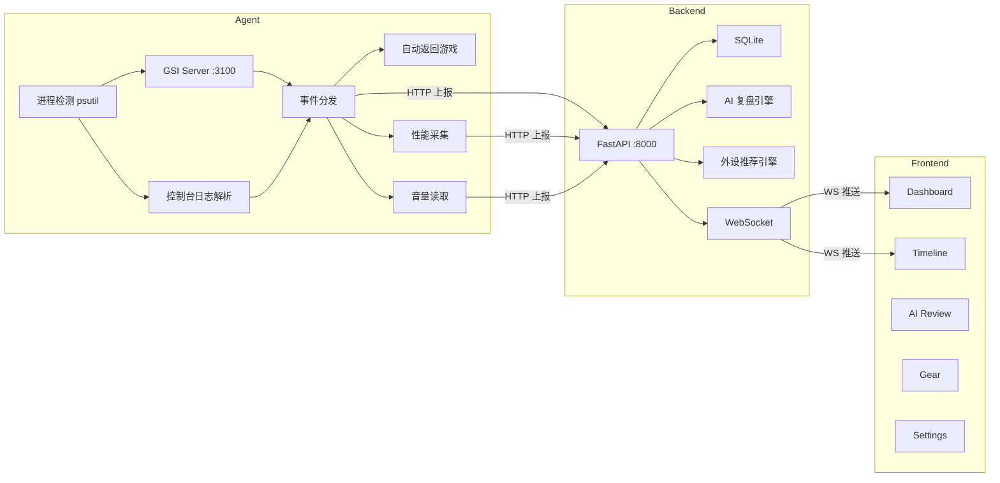

# GameDie · 本地 AI 游戏助手

> 检测电脑正在运行的射击游戏（CSGO / CS2），玩家阵亡时自动打开浏览器刷视频；看板量化死亡与娱乐时长，AI 自动复盘比赛，外设智能推荐。

## 项目背景

在《CSGO》《PUBG》《Apex》《守望先锋》这类竞技射击游戏中，玩家平均每局阵亡 5–15 次，每次复活等待 5–40 秒，这段"死亡真空期"累计占游戏总时长的 15%–25%。这段时间通常只能盯着死亡回放发呆——按每天 5 局算，单日浪费约 8 分钟，一年接近 48 小时。

GameDie 把这段"失败惩罚"反转为"娱乐奖励"：阵亡瞬间自动打开浏览器刷视频，复活或新回合开始时自动切回游戏，同时把每一秒死亡等待与观看时长量化到本地看板，并用 AI 复盘比赛。

- **选中日志/GSI 解析而非屏幕 OCR**：CS2 支持 Game State Integration，一行 JSON 的 `match_stats.deaths` 计数器就能精确判死，延迟 <1 秒，无需装 Tesseract。
- **选中本地化而非上云**：死亡次数、观看时长全部保存在本地 SQLite，不上传任何服务器，零延迟、零运维。

> 本项目是 [TRAE AI 创造力大赛](https://forum.trae.cn/c/38-category/38)（生活娱乐赛道）参赛作品，初赛帖：[【生活娱乐】gameDie-从不报点之人的福音](https://forum.trae.cn/t/topic/51097)。

## 项目结构

| 模块 | 路径 | 技术 | 说明 |
| --- | --- | --- | --- |
| 后端 | `backend/` | FastAPI + SQLite | 配置/统计/比赛/复盘/外设 API、WebSocket 实时推送 |
| Agent | `agent/` | Python + psutil + GSI | 进程检测 + GSI/日志双检测 + 自动返回游戏 + 性能采集 + LLM Agent |
| 前端 | `frontend/` | React 18 + Vite + TS + Tailwind | Dashboard / Timeline / AI 复盘 / 外设配置 / Settings |
| 展示 | `forshow/` | Three.js | 3D Landing 官网页 |
| 脚本 | `scripts/` | PowerShell | CSGO 自动配置 + 实时监控窗口 |

## 快速开始

### 环境要求

- **Python** 3.10+（加入 PATH）
- **Node.js** 18+（加入 PATH）
- **Windows**（Agent 使用 Windows API 管理窗口与音量）

### 一键启动

```powershell
.\run.bat
```

`run.bat` 会自动完成全部流程：

1. 检测并安装后端 Python 依赖（fastapi / uvicorn / pydantic）
2. 检测并安装 Agent Python 依赖（psutil / requests / pycaw / comtypes）
3. 检测并安装前端依赖（node_modules）
4. 自动定位 CS2 安装目录并写入 GSI 配置 + 控制台日志 autoexec.cfg
5. 启动后端（8000）+ Agent + 前端（5173），自动打开看板
6. 弹出实时监控窗口（显示 Agent 日志 + CSGO 日志状态）

启动后访问 `http://localhost:5173` 打开看板。关闭全部服务：关闭弹出的 4 个窗口（Backend / Agent / Frontend / Monitor）。

## 核心功能

### 1. 死亡检测与自动刷视频

CSGO/CS2 采用 **GSI 主策略 + 控制台日志兜底** 双重检测：

- **GSI（主）**：Agent 启动本地 HTTP 服务器（`127.0.0.1:3100`），自动写入 CS2 cfg 配置文件，接收游戏推送的状态 JSON，通过 `player.match_stats.deaths` 计数器递增精确判死，延迟 <1 秒，无需玩家手动配置。
- **日志（兜底）**：解析控制台日志 `Player X killed Y with Z` + 中英文关键词兜底，兼容旧版 CS:GO。

阵亡后：最小化游戏窗口 → 打开默认浏览器跳转预设视频站 → 复活/回合开始时自动切回游戏。

### 2. 自动返回游戏

| 配置项 | 说明 | 默认值 |
| --- | --- | --- |
| `auto_return_enabled` | 自动返回总开关 | 关 |
| `auto_return_on_respawn` | GSI 检测到复活/回合开始立即切回 | 开 |
| `auto_return_seconds` | 兜底超时（复活信号未到时强制切回） | 30s |

可在 Settings → 自动返回游戏 中配置，或选 10s / 30s / 60s / 自定义。

### 3. Dashboard 实时看板

- 概览卡（总死亡数、观看时长、当前游戏、最近死亡，含环比 delta + 数字滚动动效）
- 死亡趋势图（柱状/折线复合，按日/小时聚合）
- 观看时长图（堆叠面积图，按视频网站分组）
- 死亡游戏分布（环形图）
- 最近事件流（WebSocket 实时滚动，新事件高亮闪烁）
- 当前游戏状态条 + 周期选择器（今日/昨日/本周/本月/全部）

### 4. Timeline 比赛时间轴

- 比赛信息卡（比分、KDA）
- 垂直事件时间轴（击杀 / 死亡 / 回合，含 ACE / 多杀标签）
- LIVE 实时指示，新事件自动插入
- 点击跳转 AI 复盘
- 比赛历史列表

### 5. AI 复盘（Match Review）

比赛结束自动生成：
- MVP 评选 / 最佳操作 / 最大失误 / 死亡分析 / 经济分析 / AI 点评
- 默认走**规则引擎**（零配置即可用），配置 LLM Key 后切换为 **LLM 增强模式**

### 6. 外设配置 + 性能监控

- 鼠标 DPI / 键盘 / 系统音量滑块配置
- 打法 & 段位选择 → AI 推荐外设配置（基于 s1mple / ZywOo / NiKo 等职业选手 eDPI 数据）
- eDPI 分析与商品目录（罗技 / 雷蛇 / Wooting / HyperX / Artisan）
- **性能监控仪表盘**：延迟（ping Steam）/ 帧率（GSI 估算）/ 卡顿率，每 10 秒刷新，带迷你折线图

### 7. LLM Agent 子系统

| Agent | 功能 | 触发方式 |
| --- | --- | --- |
| 复盘点评 Agent | 生成比赛 AI 复盘 | Timeline → 复盘按钮 |
| 外设推荐 Agent | 个性化外设建议 | Gear → AI 推荐 |
| 死亡分析 Agent | 死亡模式与改进建议 | 比赛复盘内含 |

LLM 配置：Settings → Agent 设置，填写 API Key / Model / Base URL（OpenAI 兼容，支持 OpenAI / 豆包火山 / DeepSeek / 本地模型），点击测试连通性。不配置则走规则引擎。

## 支持的游戏

| 游戏 | 进程名 | 检测能力 |
| --- | --- | --- |
| **CSGO / CS2** | `csgo.exe` / `cs2.exe` | ✅ GSI 主 + 日志兜底（完整可用，已实测） |
| PUBG | `TslGame.exe` / `PUBG.exe` | ⏳ 占位（仅上报运行状态，OCR 待扩展） |
| Apex Legends | `r5apex.exe` / `r5apex_bin.exe` | ⏳ 占位 |
| 守望先锋 2 | `Overwatch.exe` / `Overwatch2.exe` | ⏳ 占位 |

## 前端页面

| 页面 | 路由 | 功能 |
| --- | --- | --- |
| Dashboard | `/dashboard` | 实时概览 + 统计图表 + 事件流 |
| Timeline | `/timeline` | 比赛时间轴 + 比赛历史 |
| Review | `/review/:matchId` | AI 复盘详情 |
| Gear | `/gear` | 外设配置 + 性能监控 |
| Settings | `/settings` | 重定向网站 + Agent 参数 + LLM 配置 + 自动返回 |

支持中英双语（i18next）+ 暗黑/明亮主题切换。

## 配置选项

| 配置项 | 说明 | 默认值 |
| --- | --- | --- |
| `redirect_url` | 阵亡时跳转的视频网站 | 抖音 |
| `presets` | 预设站点（抖音/B站/YouTube） | - |
| `agent.polling_interval` | Agent 进程轮询间隔 | 2.0s |
| `llm.api_key` / `model` / `base_url` | 共享 LLM 配置（OpenAI 兼容） | 空（走规则引擎） |
| `ai_agents.review.enabled` | 复盘 Agent 开关 | 开 |
| `ai_agents.gear_advisor.enabled` | 外设推荐 Agent 开关 | 开 |
| `ai_agents.death_analyst.enabled` | 死亡分析 Agent 开关 | 开 |
| `overlay.auto_return_enabled` | 自动返回游戏总开关 | 关 |
| `overlay.auto_return_seconds` | 兜底超时秒数 | 30 |
| `overlay.auto_return_on_respawn` | 复活驱动返回 | 开 |

## 默认重定向网站

- 抖音：https://www.douyin.com
- 哔哩哔哩：https://www.bilibili.com
- YouTube：https://www.youtube.com
- 自定义（看板配置页输入）

## 脚本说明

| 脚本 | 用途 |
| --- | --- |
| `scripts/setup-csgo.ps1` | 自动定位 Steam/CS2 安装目录（注册表 + 默认路径），写入 autoexec.cfg 开启控制台日志，保存日志路径 |
| `scripts/monitor.ps1` | 实时监控窗口，显示 Agent 日志末尾 + CSGO 日志路径/大小/状态 |

## 技术架构



## 规划中

- 自动录屏（OBS / Game Bar / Replay Buffer）
- 精彩时刻识别（ACE / 残局 / 连杀 / 爆头 / 翻盘）
- AI 剪辑（字幕 / 标题 / 封面 / 简介）
- Media Library 素材库
- OCR 多游戏适配（PUBG / LOL / Apex / 永劫 / 三角洲）
- Game Context Engine SDK（`npm install gamedie` → `subscribe()` 事件授权）

## 更新日志

### 2026-07-24

**优化 · 游戏网络延迟与帧率监控**（[agent/perf_collector.py](file:///d:/Project/trae比赛/gameDie/agent/perf_collector.py) + [agent/main.py](file:///d:/Project/trae比赛/gameDie/agent/main.py)）

- 新增**游戏加速器检测**：扫描运行中的进程识别 UU / 迅游 / 雷神 / 腾讯 / 奇游 / 海豚 / AK / 小黑盒 / NN 等 10+ 款加速器，上报时附带友好名称
- 新增**真实游戏服务器 IP 发现**：通过 `psutil.Process.net_connections()` 读取游戏进程的 UDP/TCP 远程连接，排除私有 IP，拿到玩家实际连接的游戏服务器 IP
- `measure_latency` 优先级调整为：游戏真实服务器 IP → 动态解析 Steam 域名 → Steam CDN IP 兜底，延迟数据更贴近玩家实际体验
- `collect()` 返回值新增 `accelerator`（加速器名）和 `server_ip`（服务器 IP）字段
- 心跳上报 `latency` 时在 `detail` 中带上加速器状态与服务器 IP，前端可展示"UU加速器 · 服务器 1.2.3.4 · 延迟 23ms"

**修复 · 自动返回游戏多开 URL**（[agent/main.py](file:///d:/Project/trae比赛/gameDie/agent/main.py) + [agent/browser.py](file:///d:/Project/trae比赛/gameDie/agent/browser.py)）

- 问题：GSI 与控制台日志双重检测同一死亡事件时，`on_death` 可能被触发两次，导致打开多个浏览器标签
- 修复：`on_death` 入口新增 **5 秒冷却防重入**（`_last_death_ts`），5 秒内重复调用直接忽略
- 加固：`start_watch_session` 开新会话前先 `end_watch_session()` 结束旧会话，避免会话叠加

**优化 · 比赛时间轴展示逻辑与 AI 分析范围**（[frontend/src/pages/Timeline.tsx](file:///d:/Project/trae比赛/gameDie/frontend/src/pages/Timeline.tsx) + [backend/ai_review.py](file:///d:/Project/trae比赛/gameDie/backend/ai_review.py)）

- Timeline 事件标签更丰富：
  - 击杀事件显示 `ACE` / `3杀` / `4杀` 标签 + 武器名（`ACE! · AWP`）
  - 死亡事件显示死亡时手持武器（`死亡 · 持 AK-47`）
  - 回合开始显示起手资金 + 持枪（`起手 $4750 · M4A1-S`）
  - 回合结束显示获胜方（`CT 赢` / `T 赢`）
  - 每个事件带回合编号角标（`R1` / `R2`）
- 实时事件合并：查看当前进行中的比赛时，DB 事件与 WS 实时事件去重合并，最新事件置顶
- AI 复盘 section 从 6 个扩展到 **8 个**：
  - 新增「**武器使用**」：击杀武器分布、主武器偏好、AWP 占比分析
  - 新增「**购买建议**」：护甲购买率、主武器配置、AWP 经济风险、Eco 策略建议
- 死亡分析增强：加入无护甲死亡统计、死亡时手持武器分布、死亡回合胜负关联分析
- MVP / 最佳操作分析加入武器信息（`第 7 回合完成 ACE（使用 AWP）`）
